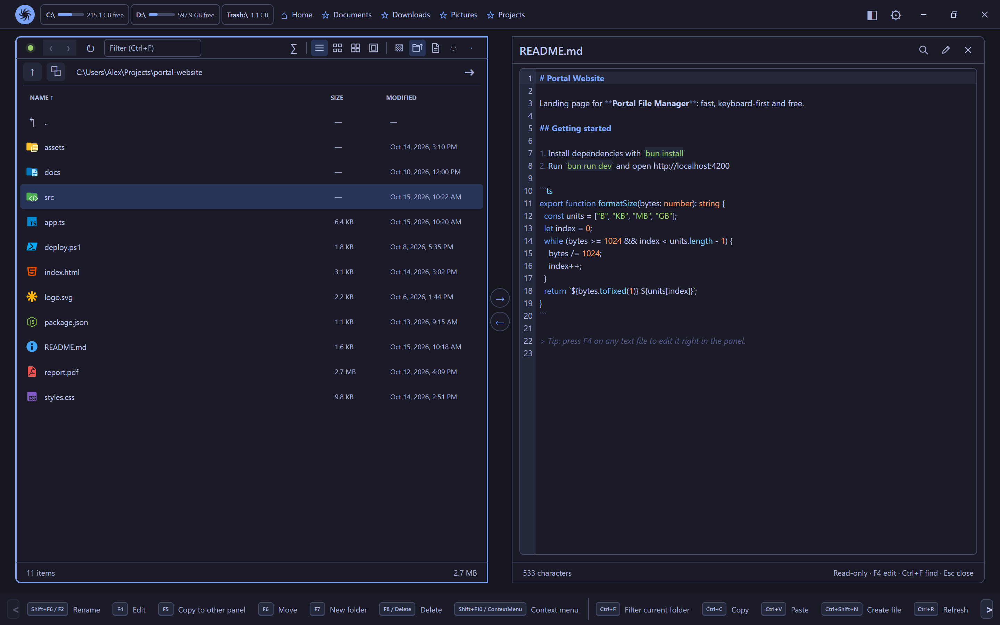

# Portal File Manager 0.2.0

*October 2026*

Welcome to Portal File Manager 0.2.0. This release is about looking inside files without leaving the app, and about making everyday work faster. Highlights:

- [Open files right in the panel](#open-files-right-in-the-panel): view text, code, PDFs and images with <kbd>Enter</kbd>, edit text with <kbd>F4</kbd>.
- [A real code editor](#a-real-code-editor): syntax highlighting for about 100 languages, find and replace, line numbers.
- [Instant updates](#instant-updates): the panels follow changes on disk without reloading.
- [More keyboard layouts](#keyboard-and-navigation): Windows Explorer and macOS, plus a folder filter.
- [Install without admin rights](#installation): the installer no longer asks for an administrator.

## Open files right in the panel

Press <kbd>Enter</kbd> on a file and it opens read-only **inside the panel** instead of launching another program:

- **Text, logs, configs and data**: `txt`, `md`, `log`, `ini`, `json`, `yaml`, `toml`, `csv` and more.
- **Scripts and source code**: `py`, `ps1`, `bat`, `sh`, `js`, `ts`, `java`, `c`, `cpp`, `cs`, `go`, `rs`, `sql` and more. A double-clicked script is now shown, not run.
- **PDFs and images**: `pdf`, `png`, `jpg`, `gif`, `webp`, `bmp`, `svg`.

Everything else still opens in its default app, and you choose the list in **Settings → File operations → Open files with extensions**. Press <kbd>Esc</kbd> to go back to the folder; the file you opened stays selected. While a file is open, the folder toolbars step aside to give it the whole panel.

## A real code editor

Press <kbd>F4</kbd> on any text file to edit it in place. The editor is built on CodeMirror, the editor used by Chrome DevTools:

- **Syntax highlighting** for about 100 languages, matched by file name, so `Dockerfile` and `Makefile` work too. Code blocks inside Markdown are highlighted in their own language.
- **Find and replace** with <kbd>Ctrl</kbd>+<kbd>F</kbd>: every match is highlighted, with match case, regular expression and whole word options.
- **Line numbers**, undo and redo, bracket matching and <kbd>Tab</kbd> indentation.
- Colors follow your theme, with a dedicated palette for each of the nine themes.
- <kbd>Ctrl</kbd>+<kbd>S</kbd> saves, <kbd>Esc</kbd> closes, and you are asked before unsaved changes are lost. In a read-only view, <kbd>F4</kbd> switches to editing.

Very large files get a warning first, and binary files are never opened as text: <kbd>F4</kbd> on an image or a program simply says *Not editable*.

## Instant updates

- **Live folders**: changes made by other programs appear within a moment, and only the changed files are updated, not the whole list.
- **No more full reloads** after copy, move, rename, delete or create: sizes, dates and previews you already see stay put.
- **Focus stays where you expect**: after a rename the renamed file stays selected; after a delete the next file is selected.

## Keyboard and navigation

- **New keyboard layouts**: Windows Explorer and macOS join Portal, Far Manager and Total Commander. Choose one in **Settings → Interface → Shortcuts**.
- **Folder filter**: <kbd>Ctrl</kbd>+<kbd>F</kbd> filters the current folder as you type, without touching the disk.
- **Context menu from the keyboard** with <kbd>Shift</kbd>+<kbd>F10</kbd> or the menu key.
- **Restore default settings** in one click; your favorites and folder history are kept.

## Look and feel

- **PDF previews**: icon views show the first page of PDF files.
- Thin, themed scrollbars everywhere.
- Borders and separators now follow dark themes instead of staying light gray.
- A cleaner editor toolbar with icon buttons.

## Installation

- **No admin rights needed**: the installer now installs for your user account only.
