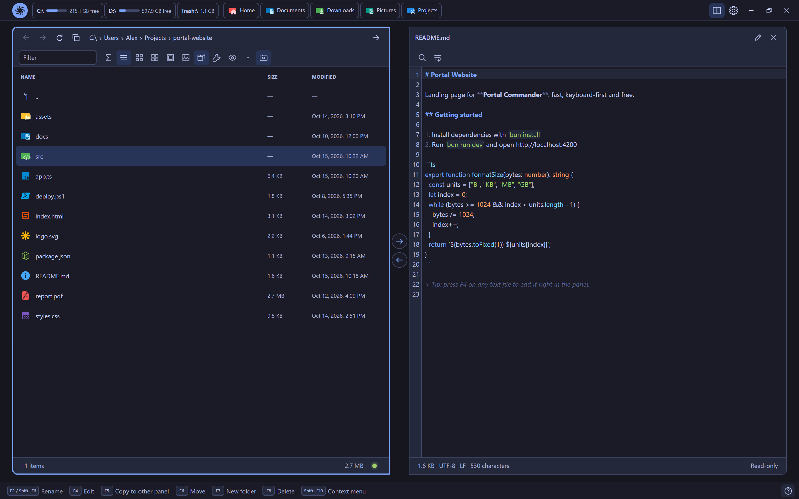

# Portal File Manager 0.3.0

*Upcoming*

Welcome to Portal File Manager 0.3.0. This release makes old text files readable again, lets the app work fully offline, and prepares Portal for macOS and Linux. Highlights:

- [Every text encoding](#every-text-encoding): Cyrillic, Chinese, Japanese and other legacy files open correctly and are saved back unchanged.
- [Works offline](#privacy): fonts and icons ship with the app; it makes no network requests of its own.
- [Ready for macOS and Linux](#macos-and-linux): native shortcuts and window controls on macOS, and better folder handling on both.

## Every text encoding

Old `readme.txt` files from CDs and archives often use legacy encodings. Portal now detects them automatically and shows them correctly in the viewer and the editor:

- UTF-8 and UTF-16, with or without a byte order mark.
- Windows code pages for Cyrillic, Western and Central European, Greek, Turkish, Hebrew, Arabic, Baltic, Vietnamese and Thai text.
- KOI8-R, KOI8-U and DOS 866 for Russian and Ukrainian.
- Shift_JIS, EUC-JP and ISO-2022-JP for Japanese; GBK, GB18030 and Big5 for Chinese; EUC-KR for Korean.

Files are **saved back in the same encoding**, with the same line endings and byte order mark, so nothing is silently converted. If you type a character the file's encoding cannot hold, Portal tells you instead of corrupting it. The editor footer now shows the encoding and line endings, for example `windows-1251 · CRLF`.

## Privacy

- **Works offline**: the fonts now ship with the app instead of loading from the internet, so Portal makes no network requests of its own. It only goes online when you open a network share or a link.

## macOS and Linux

Groundwork for the macOS and Linux versions:

- **macOS** starts with its native shortcuts and window controls, and favorites open with <kbd>Cmd</kbd>+<kbd>1</kbd> … <kbd>Cmd</kbd>+<kbd>0</kbd>.
- **Linked folders** (symbolic links) open as folders.
- **A cleaner disk list**: system and temporary volumes are hidden.
- **`~` in the address bar** opens your home folder.
- Windows-only menu items (Open with…, 7-Zip/WinRAR, the shell menu) are hidden where they cannot work, and PDF files show their regular icon instead of a broken preview.
